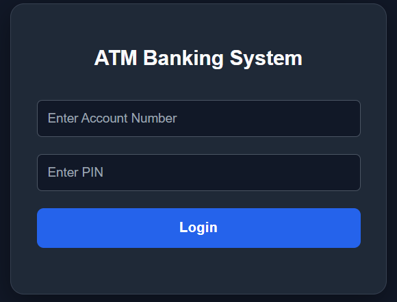

# ATM Banking System

A web-based ATM Banking System developed using Java, Spring Boot, MySQL, HTML, CSS, and JavaScript.

## Features

- User login using account number and PIN
- Secure PIN storage using BCrypt hashing
- Check account balance
- Deposit money
- Withdraw money
- View transaction history
- Change PIN
- Logout using session management

## Technologies Used

- Java
- Spring Boot
- Spring Data JPA
- MySQL
- HTML, CSS, JavaScript
- Maven
- IntelliJ IDEA

## Database

Database name: `ATMDatabase`

Tables:
- `accounts`
- `transactions`

## Configuration

Set these environment variables before running the application:

- `DB_USERNAME` – MySQL username
- `DB_PASSWORD` – MySQL password

Database URL is configured in `application.properties`.

## How to Run

1. Clone this repository.
2. Open the project in IntelliJ IDEA.
3. Create the MySQL database and required tables.
4. Configure the database environment variables.
5. Run `DemoApplication.java`.
6. Open `http://localhost:8080` in your browser.

## Project Purpose

This project was developed for learning and demonstrating Java web development, REST APIs, database connectivity, and session-based authentication.

**Note:** This is an educational ATM simulator, not a production banking application
## Screenshots

### Login Page
